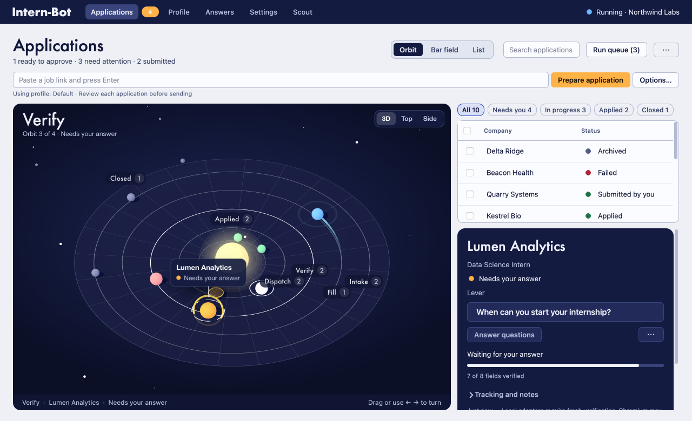
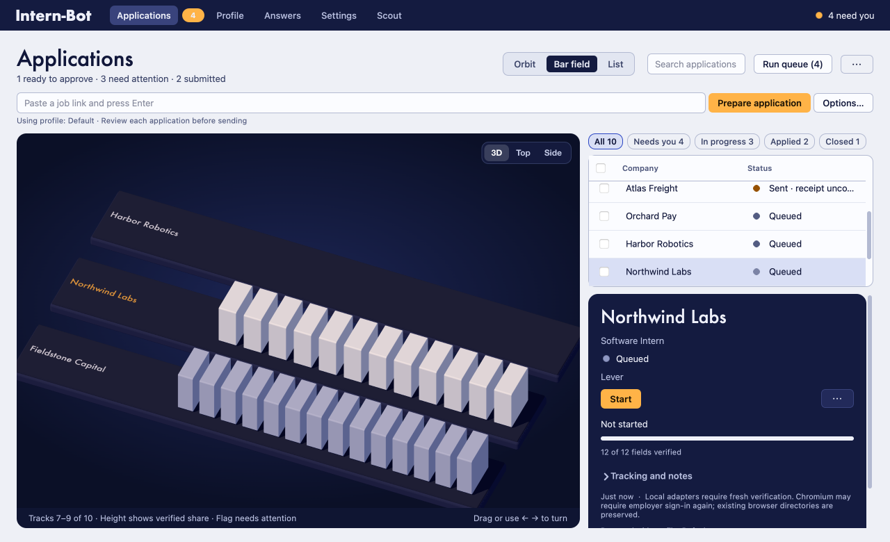

# Design System: Intern-Bot

## Overview

**Creative North Star: "The Application Orbit"**

A student opens Intern-Bot to finish an application. At a glance they should be able to tell which job they are looking at, what the form actually contains, and whose turn it is. Every visible application is a planet in one night-sky chart. Its orbit names the stage it has reached: Intake on the outside, then Fill, Verify and Dispatch, and the inner Applied orbit around the sun once an employer receipt or the student's own confirmation exists. Its mark says whose turn it is: an amber ring for a real question, a white ring for an approval, a moving comet for the one application being filled now.

The chart fills the left of Applications. The queue and a deep navy inspector with one primary action share the right column. The surrounding app uses cool paper, navy ink and a navy shell (navigation strip, sky and inspector), with amber reserved for actions and for whatever needs the student. Interaction, evidence and approval live in Qt. The chart can disappear and the workflow still works.

**Key Characteristics:**

- One orbit per stage, one planet per application, one ring that means "your turn".
- One selected application, one active run at a time, one primary action in its inspector.
- An observable field value, question or receipt behind every claim about progress.

The native captures in this guide use fictional records. Use the shipping source for behavior, the surface brief for intent and the approved draft for the form and camera of the chart. [Product brief](PRODUCT.md) · [Orbit direction](.impeccable/surfaces/application-workshop.md) · [Approved Orbit draft](docs/design-drafts/stage/index.html?d=orbit) · [Previous crew prototype](docs/design-drafts/crew/index.html)

## Colors

Light appearance pairs cool paper with navy ink. Dark appearance turns the paper navy and keeps the same ink roles in light tints. The navigation strip, the sky and the inspector stay navy in both appearances, so the chart and the decision always sit in the same night. Qt palette roles and the compiled QSS follow the macOS appearance at runtime. Read current colors from `TOKENS` when painting; paint marks that sit on the always-navy surfaces (inspector status dot, navigation status dot, planets) from `DARK`. To introduce a reusable color, change both `LIGHT` and `DARK` and reference its role in QSS. [Theme and shared widgets](gui/theme.py) · [Stylesheet](gui/styles.qss) · [Dark appearance](docs/design/dark.png)

| Native role | Light | Dark | Use |
| --- | --- | --- | --- |
| `bg` / `surface` / `surface2` | `#eef0f6` / `#fbfcff` / `#e2e6f1` | `#0a0e22` / `#121838` / `#1b2250` | Window paper, controls and tables, then quiet insets and hover. |
| `text` / `text2` / `text3` | `#11173a` / `#394267` / `#4f587d` | `#eef0fa` / `#c3cae6` / `#a4acd0` | Main reading, supporting information, then captions and placeholders. |
| `border` / `selection` | `#b3bad2` / `#d9dff5` | `#3a4479` / `#2b3570` | Control edges and the selected native row. |
| `accent` / `accent_hover` / `on_accent` | `#ffb347` / `#f5a433` / `#1d1405` | `#ffb347` / `#ffc670` / `#1d1405` | Primary action fill, its hover and its dark text. Amber is never a text color on paper. |
| `focus` | `#2b46c4` | `#ffd596` | Keyboard focus borders, checked chip border, selected tab underline and links. |
| `ready` | `#11173a` | `#ffffff` | "Ready to approve." Drawn as a ringed dot in tables and a white ringed planet in the chart. |
| `info` / `warning` | `#2453c4` / `#965100` | `#6fb6ff` / `#ffb347` | Preparing or informational feedback, then a question, intervention or uncertain send. |
| `danger` / `success` / `neutral` | `#b1243a` / `#1d7449` / `#535c82` | `#ff9a9a` / `#7ee0a8` / `#8f98c2` | Failure or removal, applied or confirmed, then queued or closed. Pair the tone with the exact label. |
| `panel` / `panel_inset` / `panel_line` | `#141b40` / `#222a5a` / `#39437c` | `#161d45` / `#232c60` / `#3d4884` | Navigation, inspector, inset question or secondary control, internal border and selected destination. |
| `panel_text` / `panel_muted` / `panel_button` | `#eef0fa` / `#b9c0e0` / `#ffb347` | Same values | Text on navy, supporting copy and the immediate action. |
| `sky` | `#0f1532` | Same value | The chart's caption bar and painted fallback; the live chart paints a radial navy gradient. |

**The One Amber Rule.** Amber fills the action and marks the student's turn: the primary button, the question ring, the navigation badge. It never decorates. Planet colors come from the same status tone as the row's dot, taken from `DARK`, so a planet and its table row always agree.

## Typography

Native labels inherit the Qt application font on macOS. Titles use Futura, which ships with macOS, so the native app, the chart overlay and the orbit headings share one display face. Create titles and copy with `label(text, role)`; the text can wrap.

| Role | Effective size / weight | Use |
| --- | --- | --- |
| `pageTitle` | Futura 30 px / 500 | One destination title: "Applications", "Profile", "Settings". |
| `inspectorTitle` | Futura 25 px / 500 | Selected employer or first-use checklist. |
| Brand | Futura 21 px / 700 | Intern-Bot in the navigation strip. |
| Orbit title | Futura 30 px / 500 | The selected application's orbit, top left of the chart, with "Orbit 3 of 4 · status" beneath. |
| `section` | 18 px / 650 | Form section or compact dialog nameplate. |
| Inspector callout | 15 px / 600 | The question or intervention that needs action. |
| Body / controls | 13 px / platform regular or control-specific weight | Values, statuses, editable fields and buttons. Filter chips use 12 px. |
| `sceneCaption` / `caption` | 12 px / 11 px | Chart caption, then evidence, help and progress counts. Table headings use 11 px at 600. |

Write in sentence case. Keep long questions, answers and employer names as data. Wrap the full question in the inspector and the full value in the review tree. A concise table row may elide text where selection opens the complete record. ReadableTree measures wrapped paragraphs and long URLs against column width. [Shared labels and row sizing](gui/theme.py) · [Review implementation](gui/views/application_dialogs.py)

## Layout

The default desktop window is 1280 × 780 logical pixels. The minimum is 1040 × 660. A full-width navy navigation strip holds the brand, five destinations and the engine's current status. Page content uses 24 px side margins, 20 px vertical margins and 12 px gaps. Shared cards use 18 px side padding, 16 px above and 18 px below.

In Applications, keep the title, attention counts, view segments, search, Run queue and the import menu on the first row. The job link, Prepare application and Options occupy the next row. Below them a horizontal splitter (12 px handle) holds the sky on the left and a right column of 360–470 px, starting at 760 / 410. The right column is a vertical splitter: filter chips, bulk bar and the queue table above, the inspector below, starting at 250 / 380. Row height is 40 px. List view hides the sky and moves the queue panel into its place, so the right column holds only the inspector. Search, sorting, record selection and the same inspector work in all three views.

**Size the table to its viewport.** Below 660 px of table viewport, hide Next step and Updated and stretch Company and Role. Below 470 px, as beside the chart, hide Role too: the inspector names it. Keep the checkbox and Status columns. Re-evaluate as either splitter moves and when the window resizes. The inspector scrolls vertically and keeps title, status, question and primary action above the fold at 1040 × 660. Put secondary actions in its menu and long notes behind "Tracking and notes." The orthographic camera frames the whole chart below the orbit title and the camera presets. [Compact window](docs/design/compact.png) · [Layout and column behavior](gui/views/tasks_view.py)

## Elevation & Depth

**The Night Chart Rule.** Depth lives in the chart. Native layers separate by tone and a single-pixel border; the sky and the inspector separate from paper by their navy fill. A selected paper row takes the `selection` fill. The checked destination and view segment take a navy fill.

The chart is a single orthographic view looking down about 41°. A translucent navy disc of radius 8.9 carries four chalk orbit lines (radii 7.8, 6.2, 4.6, 3.0 for Intake, Fill, Verify, Dispatch), a fainter Applied orbit at 1.9 around a warm sun, a rim at 8.9 for Closed records, and 24 faint spokes. Stars are fixed points below the disc. A warm directional light from above left casts soft shadows from planets onto the disc; orbit lines and rings cast none. Materials use roughness 0.78, and planets glow slightly from their own tone. The selected orbit brightens to full chalk. [Scene geometry, materials, lights and camera](gui/crew/scene.js)

## Shapes

Native buttons and inputs use a 6 px radius, navigation items 8 px, tab panes and reading surfaces 8 px, cards, tables and filter chips 10 px, the sky and the inspector 14 px. Inputs and tables retain a visible edge. Keep the amber inspector action compact enough to sit beside the secondary menu.

Planets are spheres whose size follows urgency: an application that needs the student is largest (0.36), the one being filled 0.34, a send attempt 0.27, queued 0.23, applied 0.24, closed 0.13. Marks carry meaning without color: an amber tilted ring that slowly spins is a real question, a flat white ring is "Ready to approve", a translucent body with a hollow ring is a send attempt without a receipt, and a small chalk moon is a recognized employer receipt. The selected planet grows 30 % and takes a chalk reticle of four brackets (never a closed ring, which means "Ready to approve") and a pinned name tag. The running application trails a comet arc along its orbit.

Outside Applications, `station_heading` paints a small orbit glyph from the same chart: a navy rounded tile with four rings and the destination's orbit lit in amber (Scout → Intake, Profile → Fill, Answers → Verify, Settings → Dispatch). A standard heading reserves 91 × 70 px, a compact dialog heading 62 × 48 px. The native text carries the screen name. No raster art ships for the chart. [Station heading](gui/theme.py)

## Components

### Native controls and navigation

Use `button`, `more_button`, `label`, `card`, `form_layout`, `MessageBar` and `restyle` from the shared theme. Dynamic properties select QSS variants. Forms use growing fields and left-aligned labels.

| Pattern | Decision |
| --- | --- |
| Primary and secondary | Give the current action a verb and object. Primary is an amber fill with dark text on paper and on navy. Secondary uses a bordered surface. Buttons use 5 × 12 px vertical/horizontal padding. Ghost actions recede. Danger uses the danger text tone and a confirmation for destructive record changes. A disabled inspector action drops to the navy inset with a navy line, never an amber outline. |
| View, filter and row selection | Orbit / Bar field / List are exclusive segments. A checked segment is navy. A checked filter chip has the `selection` fill and a `focus` border. A selected table row controls the inspector and the chart. Checked boxes separately choose eligible records for bulk operations. |
| Fields | Use native line edits, combos, checkboxes and file pickers for the corresponding data. A field takes 5 × 8 px padding, a `focus` border when focused and muted surface/text when disabled. State why a consequential action is unavailable where the user makes that decision. |
| Navigation | Keep Applications, Profile, Answers, Settings, Scout in that order on the navy strip. The checked destination takes the `panel_line` fill; focus is an amber border. Applications shows an amber attention count only when needed. Engine status includes a text label. Scout can flag an issue with an accessible description. |
| Feedback | Put a MessageBar near the action. Info and success messages clear after six seconds. Warnings and errors persist until superseded. Give a recovery step such as "Click Recheck on the board, then review it again." Use plain text for external wording and escape values in rich text. |

### Applications and its three views

| Choose | Use it to | Interaction |
| --- | --- | --- |
| **Orbit** | See every visible application at once, where each one stands, and which ones are waiting on you. | Each row of the sorted, filtered table is a planet. Click a planet to select its row; click an orbit label to read what that station does. Drag to turn and tilt, or focus the chart and use ← / →. 3D / Top / Side presets set the camera. |
| **Bar field** | Compare assessed fields across nearby applications, then open one that needs attention. | Tracks follow the sorted, filtered table in pages of up to three containing the selected row. Each name lies on the left of its own track. Clicking a track selects that ID in Qt. The table reaches every other page. |
| **List** | Work through a long queue, search, compare statuses or operate entirely from the keyboard. | The chart is hidden and the queue takes its place with every column. The selection, actions and inspector use the same native paths. The view preference is saved locally. |

A new queue offers Edit profile, Choose resume and Paste link under "Set up Intern-Bot". A filtered queue with no rows offers Show all applications and the chart says "No applications in this view." A selected row opens the navy inspector with company, role, status, platform, exact question or reason, one immediate action, and step or field evidence. Keep other eligible actions under More actions. "Run queue" handles queued or failed applications one at a time. [Native application view](gui/views/tasks_view.py)

### Orbit assignment and motion

The following rows describe where a planet goes and how it is marked. Read station facts from `crew_row`, and the label, tone and filter group from `status_meta`; `orbit_of` combines them. Editing the user's tracking stage changes the tracker, independently of these engine facts. [Record schema](core/automation/models.py) · [Scene projection](gui/workshop.py) · [Status and actions](gui/views/tasks_view.py)

| Model evidence | Chart | Native meaning |
| --- | --- | --- |
| Queued, newly added, or no more specific checkpoint | Intake orbit, slate planet | The application awaits preparation or a native handoff. Show the actual status or intervention. |
| `running` | The live `work_phase` orbit; blue planet with a comet arc | Intake opens the posting and loads the profile, Fill writes known facts, Verify reads them back. A new section may return to Fill. `work_phase` is transient. |
| `needs_input` with a real question | Verify orbit, amber planet with the spinning question ring | Show the employer's actual question with "Answer questions." A non-question intervention keeps the amber planet without the ring and uses its own wording. |
| `failed` with assessed fields | Verify orbit, danger-tone planet | Inspect the recorded blocker and offer its applicable recovery. |
| `ready_for_review` | Dispatch orbit, white planet with a flat ring | "Ready to approve." Read the values through "Review application." |
| `submission_attempted`, awaiting confirmation | Dispatch orbit, hollow amber planet, no moon | "Sent · receipt unconfirmed." Offer "Check receipt" and manual confirmation. The attempt blocks a second send. It never reaches the Applied orbit on its own. |
| `submission_confirmed` | Applied orbit, green planet with a chalk moon | "Applied." A recognized employer confirmation supplies this evidence. |
| `submitted_by_user`, or a tracker stage past Saved | Applied orbit, green planet, no moon | "Submitted by you" or the tracker stage. The confirmation dialog explicitly asks whether the user submitted and saw employer confirmation. |
| Archived, rejected or cancelled | The rim, small dim planet | "Closed." |

Each orbit shows at most as many planets as fit its circumference (the selected one is always kept) and labels the remainder "+N more"; the table holds every record. Orbit labels show the count of visible applications on each orbit.

Selection changes the reticle, the tag, the orbit title and the inspector. Only the application whose ID equals the active worker ID trails a comet, and only while running or actively sending. Idle motion turns each orbit's planets slowly around their own orbit at different speeds, spins the question ring, and sways the camera slowly around the chosen angle; the camera holds for four seconds after the user drags or presses an arrow key. Idle motion never moves a planet to another orbit, so it carries no information about the application. Event motion follows the engine and the student, never a timer. On a checkpoint the planet travels to its new orbit along a short spiral (1.1 s) and lands with one ring in its tone; a change of mark on the same orbit gets the ring alone. Reaching Applied also flares the sun and sends one warm ring out to the rim. A single new application scales in with a ring; a filter change or first show sweeps planets in quietly within half a second while the orbit lines fade up. A removed planet shrinks away. The running application sends out a slow ping and trails a tapering comet. Selection glides the reticle (four turning brackets) to the new planet and eases the planet, orbit line, tag and orbit title; pointing at a planet names it and pointing at a station label lights its orbit. Entering the Bar field grows the bars in a sweep, and later changes ease to the new heights. Hidden documents suspend drawing. System reduced motion or disabling "Animate the orbit chart and camera" under Settings → Automation → Orbit chart stops all of it, including event motion, and holds the static chart: every change lands at once. User-directed rotation, camera presets and native controls remain available.

If local Qt WebEngine or WebGL is unavailable, or the render process or context is lost, Qt paints the same chart flat from above (orbits, planets in their tones, the selected ring and orbit counts) or the native assessment bands and flags. The caption and inspector supply the text. List is always available. Keep the web channel display-only. It receives IDs, a company or hostname, station, status label, tone color, filter group and aggregate dispositions. It can select a visible row or explain a station. Form values, full questions, documents and credentials belong outside the scene. [Projection and fallback](gui/workshop.py) · [Local channel](gui/crew/connect.js) · [Classic checkpoints](core/automation/engine.py) · [Request-mode checkpoints](core/automation/request_engine.py)

### Reading the Bar field

Each track represents one application. Within it, the assessments in stored order are divided into at most 18 contiguous bins of nearly equal size. Each bar's height encodes the verified fraction of its own bin, from a low base for zero through full height for one. Any blocked or needs-input assessment turns the bar amber and adds a flag, even if the other assessments in that bin passed. A bin of entirely intentionally omitted fields is slate. A missing assessment record yields no bar. The selected track's name and brightest bars are chalk white and amber.

For example, 36 assessments produce 18 two-field bins. A bin with one verified and one blocked field is half of the verification range and carries a flag. A bin with two optional fields deliberately left blank stays low, slate and unflagged. Those two omissions still count as **resolved** in the native inspector. Show verified and omitted counts separately there. "No fields checked yet" covers an unassessed record. Use the field report for individual names and reasons. [Bin mapping and tests](tests/test_workshop.py)

### A walkthrough with one application

1. Paste the fictional Lumen Analytics posting and choose **Prepare application**. The active profile supplies a snapshot for this job. A slate planet appears on the Intake orbit. When the engine reports Fill and Verify, the planet moves inward with the real checkpoints and trails a comet while it runs.
2. The form asks "When can you start your internship?" The planet stops on the Verify orbit with an amber question ring. The inspector shows **Needs your answer**, the full question and **Answer questions**. Answering every required question in the form and saving lets preparation resume. A different employer can remain selected without its planet mimicking this activity.
3. Once preparation reaches review, the planet sits on the Dispatch orbit with a white ring. Choose **Review application** to read values the employer's form returned. Check the attached documents, flagged AI answers, declarations and deliberately blank optional fields. **Edit in browser** and **Recheck** update the review after an edit.
4. **Approve & send** authorizes this reviewed application and rechecks its values before sending. If another application is running, the review can still be read and sending waits. A changed form needs a fresh review. After a send attempt, the planet turns hollow on Dispatch until a receipt is checked. Only a recognized employer receipt moves it to the Applied orbit with a moon. If the student submitted it themselves and saw confirmation, record that separately with **I submitted it** or **Record employer confirmation**; it moves to Applied without a moon. [Review dialog capture](docs/design/review.png) · [Approval and receipt guards](core/automation/engine.py)

### Other destinations and dialogs

| Destination | What to put first | Native pattern and reference |
| --- | --- | --- |
| **Profile · Fill orbit** | Named profile, essential facts still missing, unsaved changes and Save profile. | Left section list and a growing form. Switching profiles saves valid edits. Existing applications keep their own snapshot. A snapshot edit explicitly names its one-application scope. [Profile capture](docs/design/profile.png) · [Profile view](gui/views/profile_view.py) |
| **Answers · Verify orbit** | The question, answer, profile, country and reuse scope. | Search questions, answers and alternate wordings. Use All answers / Needs confirmation / Approved. Expand child wordings. "AI · unconfirmed" stays visible until confirmation. Removing a wording and deleting the answer are distinct actions. [Answers capture](docs/design/answers.png) · [AnswersView](gui/views/application_dialogs.py) |
| **Settings · Dispatch orbit** | What the option changes, which provider receives a request and what is stored locally. | Scrollable Automation, AI assistance and Safety and privacy tabs. Put the motion toggle under Automation → Orbit chart. Mask keys. For connection tests show "Testing…" and a concrete result. Update privacy text for the selected endpoint and career-facts permission. [Settings capture](docs/design/settings.png) · [SettingsView](gui/main_window.py) |
| **Scout · Intake orbit** | Selected profile, search or scan state, grouped openings and source evidence. | Put source, dates, quote and "Not stated" values in the evidence pane. Search settings disclose the context preview. "Prepare application" transfers the selected active, unexpired posting and its profile snapshot to Applications. [Scout capture](docs/design/scout.png) · [ScoutView](gui/views/scout_view.py) |

Use a compact orbit heading in task dialogs and keep the consequence on the final button. Application questions show every open question at once as a scrolling form of cards. Each card uses the employer's control type and full wording, and ends with a "Remember for" switch: This application, This employer or Every application. Stable facts start at Every application, a job's specifics at This application. Declarations lock to this application and exact wording. One save stores every answer and resumes the application once no required question is open. The report and history expand below the form.

Review before sending shows the profile, source, files and the Field / Value / Note tree. Put AI-generated values, declarations and optional omissions under "Check these first." Keep long paragraphs readable at the actual column width. Older reviews missing a read-back value require Recheck. Edit in browser, Close and Approve & send have separate effects. The draft/compare assistant shows editable outgoing context, the named recipient, per-request consent and reviewable output. A filling guide shows which site and controls it covers before saving. [Question, review, snapshot and recipe dialogs](gui/views/application_dialogs.py) · [Draft and comparison dialog](gui/views/assistant_dialog.py)

### Extending a screen

Suppose a change asks for the employer's stated start date to be easier to find in Scout. Select a fictional result in the running Scout screen or a GUI fixture. Use the native capture as a layout reference and locate the existing "Start date" entry in `ScoutView.show_selected`. Move that entry earlier in the evidence pane. Read `item.evidence.get("start")`, preserve its source quote, escape both strings and keep "Not stated" when the employer supplied no date. Use the existing text browser and leave "Prepare application" tied to the selected posting's eligibility. Check one missing date, a long source quote, keyboard selection and a compact window. The same approach works for other evidence fields already on that record. [Scout layout reference](docs/design/scout.png) · [Evidence renderer](gui/views/scout_view.py)

### Keyboard and accessibility

| Scope | macOS behavior |
| --- | --- |
| Main window | ⌘1 Applications, ⌘2 Profile, ⌘3 Answers, ⌘4 Settings, ⌘5 Scout. ⌘N opens Applications and focuses Job link. ⌘F focuses application search. ⌘R invokes the selected application's enabled primary action. |
| Focused application table | Return / Enter invokes the row action. Delete or Backspace starts the applicable confirmation for checked or selected records. Typing in a text editor retains normal editing behavior. |
| Profile / Answers | ⌘S saves inside Profile. Delete and Backspace in the Answers tree act on the selected answer or wording. |
| Chart | Focus then ← / → turns it. Orbit labels and camera presets are buttons inside the chart. The caption supplies the selected orbit, employer and status or the track legend. Every consequential action has a native path. |

Give icon-only or ellipsis controls an accessible name and tooltip. Show selection through shape, contrast and text as appropriate; status dots and planets pair their tone with a shape (ring, hollow, moon) and the exact label. Focused controls use 2 px `focus` borders; focused navigation items and inspector actions use amber or light borders on navy. Keep the text count beside the progress indicator and the full employer step in the accessible description. Scope custom editing shortcuts to the focused native editor or item view. [Window navigation](gui/main_window.py) · [Editing shortcuts](gui/shortcuts.py) · [Table, stepper and inspector](gui/views/tasks_view.py)

## Do's and Don'ts

### Do

- Do bind every planet, field count, question and receipt to the same run ID as the inspector.
- Do retain the exact question, the reviewed value and who confirmed a submission in native text.
- Do keep the decision and its action visible at compact width and with chart motion disabled.
- Do name the recipient, the data and the scope before a user sends context or approves an answer.

### Don't

- Don't move a planet between orbits on a timer or without an engine checkpoint.
- Don't represent an optional omission as a verified value, a send attempt as a receipt or a manual attestation as machine evidence: no moon without a recognized receipt, no Applied orbit for a send attempt alone.
- Don't put personal form contents or a submit action in the scene bridge.
- Don't use amber as decoration or as text on paper.

### Acceptance checklist for a UI change

- [ ] At 1280 × 780 and 1040 × 660, select a long-named job with a full question. Read its status, reach the primary action and open secondary actions. Drag both splitters across the table's 470 px and 660 px thresholds.
- [ ] Select a different row while one job runs. Filter and sort, switch Orbit / Bar field / List, click a planet and an orbit label, then select a track from the second page. The inspector, caption, chart and table agree on the visible application ID.
- [ ] Load more applications than an orbit holds and confirm the selected one stays drawn and "+N more" appears. Compare mixed and wholly omitted bins, an unassessed row, and native verified/resolved counts. Confirm the question ring needs a real question.
- [ ] Inspect a ready review while a different job runs. Read the full values. Distinguish uncertain send, employer receipt and manual confirmation in the chart and the inspector. Check that a second send is unavailable.
- [ ] Test light and dark appearance, the system reduced-motion preference, the in-app toggle and the painted fallback. Navigate with the keyboard in List and confirm shortcuts stay scoped while an editor has focus.

Run the existing [projection tests](tests/test_workshop.py), [GUI workflow tests](tests/test_gui.py), [theme contrast tests](tests/test_theme.py) and [keyboard tests](tests/test_shortcuts.py) for affected paths. Review the chart and native focus on macOS when changing rendering or interaction.
