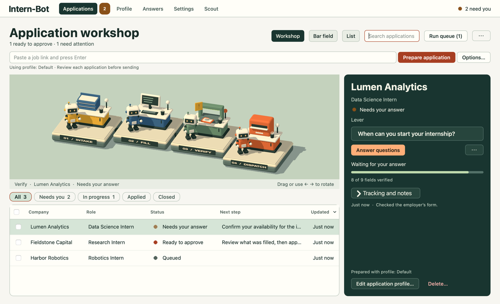

<p align="center">
  <a href="docs/design/workshop.png">
    
  </a>
</p>

# Intern-Bot

Intern-Bot is a local macOS desktop app (Python and PySide6) for internship applications. It keeps your profiles and approved answers, fills application forms in a visible Chromium window, and tracks every application from saved to offer.

Autofill runs all **28 site-specific SpeedyApply 2.28.0 adapters** inside a local Chromium extension that Playwright controls directly. No SpeedyApply account, server or AI is needed for normal autofill. Optional AI (a local model, Claude, OpenAI, Gemini, DeepSeek or any OpenAI-compatible server) fills factual questions your profile doesn't cover by name, under the privacy rules below.

> This is a private personal integration of proprietary user-supplied code, not an open-source release of SpeedyApply. See the [acceptance record](docs/speedyapply-acceptance.md) for fixture coverage, benchmarks and live-site limitations.

The [UI and UX style guide](DESIGN.md) explains the four stations, application states, native controls and how to extend each screen. Its screenshots use fictional records.

## What it does

- **Profiles.** Named profiles with contact details, education, experience, languages, work eligibility, a résumé and an optional cover letter. Unknown yes/no answers stay unknown; nothing is guessed.
- **Autofill.** Supported sites (Workday, Greenhouse, Lever, Ashby, SmartRecruiters, Workable and 22 more, plus DOM-detected Phenom) are filled by their adapter, and every field is read back and verified.
- **Workday Request mode.** Signs in with your saved employer login, answers application questions through Workday's API, then finishes the remaining pages in the browser with the same checks as Classic mode.
- **Approved answers.** Each answer you approve is reused for the same question and any rewording you link to it, within its profile, scope and country.
- **AI autofill (optional).** Unknown or reworded factual questions (graduation year, degree level, LinkedIn URL) are linked to your profile or answered from your career facts. AI answers fill the form, show as *AI · unconfirmed* under **Answers**, and block automatic submission until you confirm them.
- **Tracking.** Pipeline stage, notes, job description and history for each application, with CSV import and export.
- **Scout.** Finds internships and student-eligible jobs using public employer pages, official boards and your configured AI provider. Keeps posting evidence and a deduplicated history for each profile.
- **You submit.** Automatic submission is off by default. It needs per-application authorization and stops on anything it can't verify.

## Install and run

Double-click **Start Intern-Bot.command** in Finder. The first launch creates `.venv`, installs the requirements and downloads Chromium.

Or from a terminal:

```sh
python3 -m venv .venv
source .venv/bin/activate
python -m pip install -r requirements.txt
python -m playwright install chromium
python main.py
```

The app loads the checked-in extension into bundled Chromium automatically, so you don't install anything in your regular browser. Playwright is pinned to 1.59.0 for MV3 worker-restart support.

Upgrading from the Chrome/Firefox version keeps your records and browser directories. Resuming opens a separate Chromium session and may require employer sign-in again. Pending drafts lose their old field-verification checkpoints and are re-checked by the new engine; historical applications and submission-attempt flags are kept.

## Using it

### 1. Set up a profile

Open **Profile** and work through its sections (Name, Contact, Documents, Citizenship & eligibility, Education, Experience and so on). Documents keep their original bytes and file type. **Save profile** (⌘S) lights up when there are unsaved changes, and the header lists any essentials still missing.

Under **Citizenship & eligibility**, **Authorized to work in job's country** defaults to **Yes** for Singapore applications. Enter citizenship as a country (for example, Singapore) and nationality as it appears on your documents (for example, Singaporean). These fields are optional; blank or Unknown answers are asked during each application. Saved No and Unknown work-authorization choices are preserved.

Use the profile switcher and its ⋯ menu to create, import or export named profiles. Saving a profile affects new applications only. To change one application's copy, use **Edit application profile…** in its inspector.

### 2. Workday logins (optional)

Employer logins live in a 1Password vault named **Job Sites**. The bot reads them through the 1Password CLI with a service account, so the 1Password app doesn't need to be open and you won't see a prompt. Setup:

1. `brew install 1password-cli`
2. Create a vault named **Job Sites** in 1Password.
3. On 1Password.com, open **Developer → Service Accounts** and create one with read and write access to **Job Sites** only. Set an expiry.
4. Paste the token under **Profile → Workday logins** and click **Save token**. The token is stored in the macOS keychain and checked against the vault right away.

The bot matches a login to an employer by the Workday address on the 1Password item, so logins you add to **Job Sites** yourself are picked up too. Each login is used only for its own employer. **Check login** shows which account the bot will use and never shows the password. If you used the keychain-only version before, **Import keychain logins** copies the saved logins for your existing applications into 1Password and leaves the keychain copies as a backup.

Anyone with the token can read and write **Job Sites** without a prompt. If it leaks, revoke it in 1Password.

With **Create Workday accounts automatically** on, an employer with no saved login gets one with your profile email or a catch-all address such as `{company}_intern@yourdomain.com`. 1Password generates the password and stores the login before the browser sees it. The bot then creates the account once and waits. Open Workday's verification email yourself, click **I've verified my account**, and the bot signs in once. Approve the Create Account terms checkbox with **Employer** scope so you're asked once per employer. CAPTCHAs, mailbox access and unfamiliar sign-in flows stay manual.

### 3. Add and run applications

In **Applications**, press ⌘N, paste an HTTPS job link and press Return to prepare it with the active profile. **Options…** lets you choose the profile, site mode and whether to queue it first. Unrecognized pages still open for detection but you finish them by hand; ambiguous application frames are handed off to you.

For Workday, choose **Request** mode to answer questions through the API. It never creates accounts.

**Workshop** places the selected application at Intake, Fill, Verify or Dispatch. **Bar field** shows field assessments for up to three visible applications at a time. **List** gives the queue the full left pane. The view is remembered. Turn off worker animation under **Settings → Automation → Workshop display**.

Select an application and press its primary action (**Start**, **Resume** or **Retry**; ⌘R or Return), or use **Run queue**. Queues run one at a time and skip submitted applications and anything waiting on you. Pause and cancel stop further adapter writes and pending timers.

### Unsupported sites: teach them once

When a site has no adapter, the application stops with **Teach by filling it in** and **Let AI teach itself**. Either way Intern-Bot saves a *recipe* for that site, so later applications there (another internship at the same company, say) fill without AI.

- **Teach by filling it in.** Fill the application in Chromium as usual, then click **Finish teaching**. Intern-Bot learns which buttons continue and submit, which controls are custom dropdowns, and the confirmation page, and offers to keep the answers you typed. No AI is used.
- **Let AI teach itself.** The AI fills the application page by page and stops at the review page. It sees field labels, options, button text and your profile field names, never the values. Answers it picks show as *AI · unconfirmed*.

You review each recipe before it's used. A recipe stores no personal values. Until it has seen the site's confirmation page, you submit on that site yourself and press **I submitted it** on the confirmation page.

### 4. Answer questions

When an application needs a fact or hits a conflict, open **Answer questions**. The dialog moves to the next open question after each save and offers **Resume application** once required questions are answered. Each question starts from what the form already holds, or from the saved answer the form didn't take. Optional questions you leave empty are left blank on the form. The **Needs you** filter shows everything waiting on you.

New answers apply to every application by default, or only to this application or employer. If a question rewords one you've already answered, pick the original under **Same as** and the new wording joins that answer. Existing conflicting values are kept until you resolve them. Broad vendor guesses and hard-coded personal answers are blocked.

For recognized Workday résumé controls, approving a file answer authorizes replacing an existing upload. Having a file in your profile does not.

### 5. Review and submit

Check the form in the browser and submit it yourself, or authorize automatic submission for that one application. Automatic submission also requires verified fields and a verified review page. The attempt is recorded before the click and never retried. A click or a vendor "saved application" event is not treated as success; only a recognized employer receipt or your **I submitted it** confirms a submission.

### 6. Track

The detail panel holds pipeline stage, notes and the job description, and saves as you type. Import and export CSV from the ⋯ menu beside **Run queue**. Imports never start applications.

### Scout

Open **Scout** (⌘5), choose a saved profile, and edit its search brief and priority sources. Choose **Internships**, **Jobs**, or **Both**. **Scan now** previews the exact applicant context before the first AI request. **Scan daily** runs at 8:00 a.m. Singapore time while the app is open, with a catch-up scan when it next opens or wakes. Changes to the provider or shared context require a new preview; until then daily scans pause and Scout shows **!** in the top navigation. Priority sources take one `Name | URL` (or bare URL) per line, and lines starting with `#` are ignored.

Scout reuses the provider, model and Keychain key in Settings. OpenAI and Claude use native web search when the selected model supports it. An optional Brave Search API key enables broad discovery with any provider. Direct public sources are checked in either case. Each run allows up to six discovery requests and 40 candidate postings, with source failures and limits shown under coverage. Public pages that require JavaScript may open in a separate Chromium window. Private university portals and sign-in-only pages appear as unavailable.

Results need an independently opened posting and source excerpts proving it is open. Open postings are grouped by their verified posting date: the last 48 hours first, then those posted earlier, then undated leads. Deadlines within 14 days come first, and missing terms show **Not stated**. **Latest scan** shows every opportunity the most recent scan verified as open, with first sightings marked **New**; **All saved** shows the history. **Prepare application** uses the matched profile snapshot and starts or queues autofill in Applications, where you review submission as usual.

Scout starts its own history in SQLite and generates `data/opportunities-log.md`. The log is rebuilt from saved records so an export failure can be repaired by the next scan. Scan limits bound request counts; actual API charges depend on the model and search provider.

### Answers and Settings

**Answers** lists every approved answer. Expand one to see each wording matched to it and remove a wrong wording on its own.

**Settings** saves immediately and covers automatic continuation, answer reuse and AI. Choose a provider:

- **Local or OpenAI-compatible** (the default): a server on this Mac such as LM Studio (`http://localhost:1234/v1`) or Ollama (`http://localhost:11434/v1`), or any https OpenAI-compatible API (OpenRouter, Groq and similar). Enter the model name; a key is only needed if the server asks for one. Larger models answer more questions: in testing, Gemma 4 26B linked questions that Qwen 3.5 9B left unanswered.
- **Claude** (default `claude-opus-5-5`, through the official SDK at low effort, no retries), **OpenAI** (`gpt-6-luna`), **Gemini** or **DeepSeek** (`deepseek-flash`; processed in China). Each keeps its own model and keychain key.

With **Fill unknown and reworded questions with AI** on (the default once a provider is set up), each unanswered factual question is sent once. The reply can only point to one of your saved questions or a named profile field, or, when career facts are allowed, give a short answer that must be one of the form's options. Anything else is ignored and the question is asked as usual. Links to profile fields follow later profile edits and apply to every application. Answers worked out from career facts apply to that application only. **Confirm AI answer** under **Answers** makes one yours.

**Compare profiles with AI…** and **Draft with AI…** show the exact outgoing context (names, emails, phone numbers and links masked) and ask for consent first. Drafts need your approval before they become reusable answers.

The app follows the macOS light or dark appearance. Closing it closes the browser sessions it owns; your records stay.

## Data and privacy

- `data/intern-bot.sqlite3` holds profiles, answers, application snapshots, assessments and history. It has owner-only permissions but is not encrypted.
- Employer logins live only in your 1Password **Job Sites** vault. The service account token and Gemini/OpenAI keys live only in the macOS keychain. There is no plaintext fallback.
- `data/browser/<run-hash>/` holds isolated, exclusively locked Chromium sessions. Older browser directories are preserved.
- The extension keeps run, tab and document bindings in memory-only `storage.session`. It never persists profile facts, documents, credentials or approvals.
- Normal autofill makes no SpeedyApply, Supabase, telemetry or local HTTP-server calls.
- AI autofill sends only what the provider needs:
  - **A model on this Mac:** question wording, form options, your saved question wordings, profile field names and your career facts (education, experience, skills, languages, summary). Nothing leaves the computer.
  - **A cloud provider:** question wording, form options, saved question wordings and the *names* of profile fields that have a value, never their values. Turning on **Also let … see your career facts** per provider adds career facts with your names, email, phone, address and links masked.
  - **Never through AI autofill:** contact or identity values, documents, credentials, page content, or essay, demographic, health, legal-status, pay and consent questions (including lone checkboxes).
  - **Scout:** after its context preview is approved, the selected provider receives the redacted search brief, relevant career facts, citizenship/country criteria, and public posting text. Search services receive search criteria. Application browser sessions and documents are excluded.
  - Cloud URLs must use https. Redirects are refused, and errors never echo request content. Each request is logged by kind (provider, local or cloud, number of questions, whether facts were sent), never by content.

The original XPI, exact source and notices are kept under [`third_party/speedyapply/2.28.0/`](third_party/speedyapply/2.28.0/). The loaded extension contains only the adapted dependency graph and local controls; see [extension internals](extension/README.md).

## Development

Node is only needed to rebuild the adapter package:

```sh
npm ci --prefix extension --ignore-scripts
npm run build --prefix extension
npm test --prefix extension
```

Tests:

```sh
.venv/bin/python -m pytest -q                   # everything
.venv/bin/python -m pytest -q -m "not browser"  # unit tier without Chromium, about a second
PYTHONPATH=. .venv/bin/python tools/benchmark_adapters.py --output /tmp/intern-bot-benchmark.json
```

Tests run the real adapter functions against fictional forms with intercepted network requests.

## Limitations

- Unknown widgets, unrecognized upload receipts, extra or unmatched rows and unrecognized review summaries become manual handoffs. Only recognized native or accessible controls can be verified, and multi-step reviews need independently labeled saved values before automatic submission.
- Passing fixtures shows the adapters are implemented, not that they work on every employer's current form. Live employer acceptance and live submissions have not been performed.
- Browser ownership uses POSIX locking; operating systems other than macOS are unverified.
