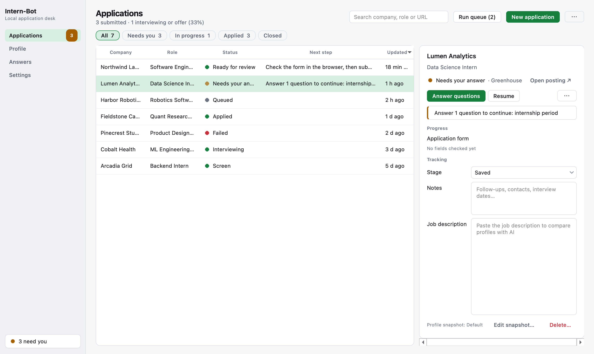

# Intern-Bot



Intern-Bot is a local macOS desktop app (Python and PySide6) for internship applications. It keeps your profiles and approved answers, fills application forms in a visible Chromium window, and tracks every application from saved to offer.

Autofill runs all **28 site-specific SpeedyApply 2.28.0 adapters** inside a local Chromium extension that Playwright controls directly. No SpeedyApply account, server or AI is needed for normal autofill. Gemini or OpenAI assistance is optional and only runs when you ask.

> This is a private personal integration of proprietary user-supplied code, not an open-source release of SpeedyApply. See the [acceptance record](docs/speedyapply-acceptance.md) for fixture coverage, benchmarks and live-site limitations.

## What it does

- **Profiles.** Named profiles with contact details, education, experience, languages, work eligibility, a résumé and an optional cover letter. Unknown yes/no answers stay unknown; nothing is guessed.
- **Autofill.** Supported sites (Workday, Greenhouse, Lever, Ashby, SmartRecruiters, Workable and 22 more, plus DOM-detected Phenom) are filled by their adapter, and every field is read back and verified.
- **Workday Request mode.** Signs in with your saved employer login, answers application questions through Workday's API, then finishes the remaining pages in the browser with the same checks as Classic mode.
- **Approved answers.** Each answer you approve is reused for the same question and any rewording you link to it, within its profile, scope and country.
- **Tracking.** Pipeline stage, notes, job description and history for each application, with CSV import and export.
- **You submit.** Automatic submission is off by default. It needs per-application authorization and stops on anything it can't verify.

## Install and run

Double-click **Start Intern-Bot.command** in Finder. The first launch creates `.venv`, installs the requirements and downloads Chromium.

Or from a terminal:

```sh
python3 -m venv .venv
source .venv/bin/activate
python -m pip install -r requirements.txt
python -m playwright install chromium
python main.py
```

The app loads the checked-in extension into bundled Chromium automatically, so you don't install anything in your regular browser. Playwright is pinned to 1.59.0 for MV3 worker-restart support.

Upgrading from the Chrome/Firefox version keeps your records and browser directories. Resuming opens a separate Chromium session and may require employer sign-in again. Pending drafts lose their old field-verification checkpoints and are re-checked by the new engine; historical applications and submission-attempt flags are kept.

## Using it

### 1. Set up a profile

Open **Profile** and work through its sections (Name, Contact, Documents, Work eligibility, Education, Experience and so on). Documents keep their original bytes and file type. **Save profile** (⌘S) lights up when there are unsaved changes, and the header lists any essentials still missing.

Use the profile switcher and its ⋯ menu to create, import or export named profiles. Saving a profile affects new applications only. To change one application's copy, use **Edit snapshot…** in its detail panel.

### 2. Workday logins (optional)

Under **Profile → Workday logins**, save employer credentials to the macOS keychain. Each login is used only for its own employer.

With **Create Workday accounts automatically** on, an employer with no saved login gets one generated from your profile email or a catch-all address such as `{company}_intern@yourdomain.com`. The bot saves it to the keychain, creates the account once and waits. Open Workday's verification email yourself, click **I've verified my account**, and the bot signs in once. Approve the Create Account terms checkbox with **Employer** scope so you're asked once per employer. CAPTCHAs, mailbox access and unfamiliar sign-in flows stay manual.

### 3. Add and run applications

**Applications → New application** (⌘N) takes an HTTPS job URL (prefilled from the clipboard) and a profile, and tells you whether the site has a supported adapter. Unrecognized pages still open for detection but you finish them by hand; ambiguous application frames are handed off to you.

For Workday, choose **Request** mode to answer questions through the API. It never creates accounts.

Select an application and press its primary action (**Start**, **Resume** or **Retry**; ⌘R or Return), or use **Run queue**. Queues run one at a time and skip submitted applications and anything waiting on you. Pause and cancel stop further adapter writes and pending timers.

### 4. Answer questions

When an application needs a fact or hits a conflict, open **Answer questions**. The dialog moves to the next open question after each save and offers **Resume application** once required questions are answered. The **Needs you** filter shows everything waiting on you.

New answers apply to every application by default, or only to this application or employer. If a question rewords one you've already answered, pick the original under **Same as** and the new wording joins that answer. Existing conflicting values are kept until you resolve them. Broad vendor guesses and hard-coded personal answers are blocked.

For recognized Workday résumé controls, approving a file answer authorizes replacing an existing upload. Having a file in your profile does not.

### 5. Review and submit

Check the form in the browser and submit it yourself, or authorize automatic submission for that one application. Automatic submission also requires verified fields and a verified review page. The attempt is recorded before the click and never retried. A click or a vendor "saved application" event is not treated as success; only a recognized employer receipt or your **I submitted it** confirms a submission.

### 6. Track

The detail panel holds pipeline stage, notes and the job description, and saves as you type. Import and export CSV from the ⋯ menu next to **New application**. Imports never start applications.

### Answers and Settings

**Answers** lists every approved answer. Expand one to see each wording matched to it and remove a wrong wording on its own.

**Settings** saves immediately and covers automatic continuation, answer reuse and AI. Pick **Gemini** or **OpenAI** (default model `gpt-6-luna`); each provider keeps its own model and keychain key. With a key saved, **Match reworded questions** (on by default) sends only the wording of unanswered questions and your saved questions, never answers or profile values. **Compare profiles with AI…** and **Draft with AI…** show the exact outgoing context and ask for consent first, and drafts need your approval before they become reusable answers.

The app follows the macOS light or dark appearance. Closing it closes the browser sessions it owns; your records stay.

## Data and privacy

- `data/intern-bot.sqlite3` holds profiles, answers, application snapshots, assessments and history. It has owner-only permissions but is not encrypted.
- Employer credentials and Gemini/OpenAI keys live only in the macOS keychain. There is no plaintext fallback.
- `data/browser/<run-hash>/` holds isolated, exclusively locked Chromium sessions. Older browser directories are preserved.
- The extension keeps run, tab and document bindings in memory-only `storage.session`. It never persists profile facts, documents, credentials or approvals.
- Normal autofill makes no SpeedyApply, Supabase, AI, telemetry or local HTTP-server calls. Optional AI requests contain only the context shown in the consent dialog.

The original XPI, exact source and notices are kept under [`third_party/speedyapply/2.28.0/`](third_party/speedyapply/2.28.0/). The loaded extension contains only the adapted dependency graph and local controls; see [extension internals](extension/README.md).

## Development

Node is only needed to rebuild the adapter package:

```sh
npm ci --prefix extension --ignore-scripts
npm run build --prefix extension
npm test --prefix extension
```

Tests:

```sh
.venv/bin/python -m pytest -q                   # everything
.venv/bin/python -m pytest -q -m "not browser"  # unit tier without Chromium, about a second
PYTHONPATH=. .venv/bin/python tools/benchmark_adapters.py --output /tmp/intern-bot-benchmark.json
```

Tests run the real adapter functions against fictional forms with intercepted network requests.

## Limitations

- Unknown widgets, unrecognized upload receipts, extra or unmatched rows and unrecognized review summaries become manual handoffs. Only recognized native or accessible controls can be verified, and multi-step reviews need independently labeled saved values before automatic submission.
- Passing fixtures shows the adapters are implemented, not that they work on every employer's current form. Live employer acceptance and live submissions have not been performed.
- Browser ownership uses POSIX locking; operating systems other than macOS are unverified.
