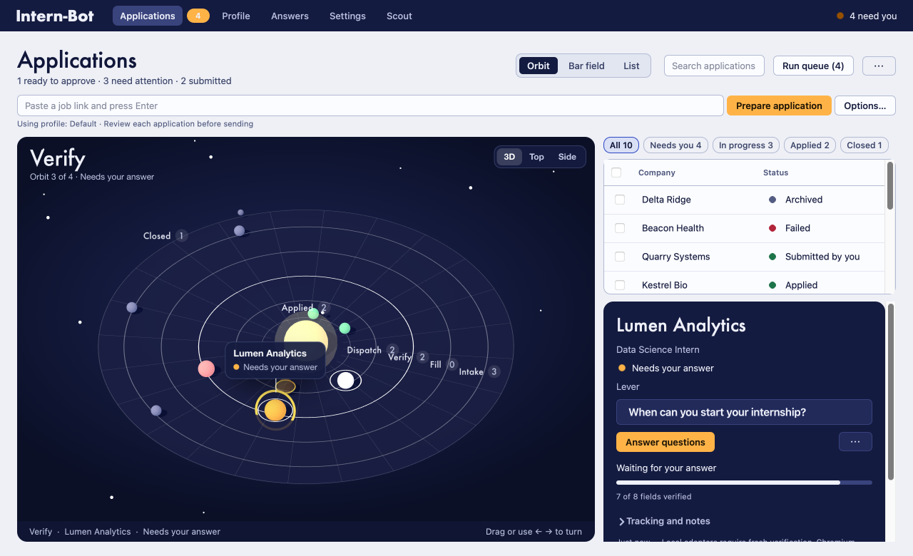

[View the still banner](docs/design/readme-orbit-banner.png)

# Intern-Bot

**Your applications, in orbit.**

A local macOS application desk for internship hunting. Find openings, fill forms in a visible browser, reuse answers you have approved, and keep track of every application—from the first saved link to an offer.

The Orbit view makes each application a planet. Its orbit shows how far preparation has progressed; its ring tells you when it needs your attention. The queue and inspector keep the actual questions, field values, and next action beside the chart.

**macOS · Python + PySide6 · Bundled Chromium · Optional AI**

[Get started](#get-started) · [Features](#what-you-can-do) · [Supported sites](#supported-sites) · [Privacy](#data-and-privacy) · [Development](#development)

> This repository includes a private personal integration of proprietary SpeedyApply 2.28.0 code. It is not an open-source release or a relicense of that code. See [provenance and acceptance](docs/speedyapply-acceptance.md) before redistributing it.

## What you can do

| Feature | How it helps |
| --- | --- |
| **Orbit workspace** | Follow Intake → Fill → Verify → Dispatch → Applied. Switch to Bar field for field-verification progress or List for the queue. |
| **Named profiles** | Keep contact details, eligibility, education, experience, languages, résumés, and cover letters together. Each application gets its own profile snapshot. |
| **Verified autofill** | Fill supported forms using your profile and scoped answers, then read values back. Conflicts, unknown facts, and unsupported controls become questions or manual handoffs. |
| **Reusable answers** | Remember answers for one application, one employer, or every application. Link alternate question wordings and review proposed library changes with **Organise with AI…**. |
| **Scout** | Discover internships and student-eligible jobs from public sources. Inspect posting evidence, dates, and eligibility before preparing an application. |
| **Employer accounts** | Use a dedicated 1Password vault for sign-in and optional account creation. Workday also offers a Request mode that answers questions through its API before finishing in the browser. |
| **Teach a site** | Demonstrate an unsupported form yourself or let optional AI propose a filling recipe. Review the recipe before reuse. |
| **Application tracking** | Keep pipeline stages, notes, job descriptions, and history. Import or export CSV; importing never starts an application. |

Normal autofill needs no AI provider, SpeedyApply account, subscription, or cloud backend. Optional AI can match reworded questions, draft answers, compare profiles, organise saved answers, and help Scout find openings.

### A chart with a job to do

- A **blue comet** follows the application currently running.
- An **amber question ring** marks an application waiting for your answer.
- A **white ring** means it is ready for review.
- A **green planet** means applied; a small chalk moon distinguishes a recognized employer receipt from your own confirmation.
- A send attempt without a receipt stays at **Dispatch**, visibly unconfirmed.

The app follows macOS light and dark appearance, supports keyboard navigation and reduced motion, and offers a flat chart fallback when WebGL is unavailable. Disable animation in **Settings → Automation → Orbit chart**.

<details>
<summary>See the native interface</summary>



The [design guide](DESIGN.md) includes dark appearance, the other views, keyboard behavior, and the chart's state meanings. All pictured records are fictional.

</details>

## Get started

### Platform and requirements

| Component | Support |
| --- | --- |
| **Desktop** | macOS. The recorded acceptance run used Apple Silicon and Python 3.13.13. Intel Macs and other operating systems are unverified; browser ownership currently uses POSIX locking. |
| **Python** | Use Python 3.13 to match the recorded acceptance environment. Dependencies are in [`requirements.txt`](requirements.txt). |
| **Browser** | Playwright's bundled Chromium, installed below. The local extension loads automatically into an isolated session. |
| **Credentials** | An available system keychain. 1Password CLI and a service account are optional for employer-account automation. |
| **Node.js** | Needed only to rebuild or test the extension, not to run the app. |

From the repository root:

```sh
python3 -m venv .venv
source .venv/bin/activate
python -m pip install -r requirements.txt
python -m playwright install chromium
python main.py
```

Or double-click **Start Intern-Bot.command** in Finder. On first launch it creates `.venv`, installs the requirements, and downloads Chromium. Python must already be installed. For an existing environment after an update, rerun the dependency and Chromium installation commands above.

Playwright is pinned to **1.59.0** for Manifest V3 worker-restart support. You do not need to install the extension in your regular browser.

### Your first application

1. **Save a profile.** Open **Profile**, fill in your details, and attach your documents. Check eligibility answers explicitly: Singapore work authorization starts at Yes; saved No and Unknown choices are preserved. Unknown facts are asked when needed.
2. **Paste a job link.** In **Applications**, press **⌘N**, enter an HTTPS posting URL, and choose **Prepare application**. Use **Options…** to change the profile, choose Workday Request mode, or queue the job first.
3. **Resolve what needs you.** Inspect the selected application's next action. **Answer questions** shows the open questions together; save your answers to continue. Unanswered optional fields can stay blank and appear in the review.
4. **Review the actual form.** Choose **Review application** and check the returned values, attached documents, AI answers, declarations, and omissions. Use **Edit in browser** and **Recheck** if anything needs changing.
5. **Submit and track.** Submit in the browser yourself, or choose **Approve & send** for this reviewed application. Record your own confirmed submission with **I submitted it**. Update the tracking stage and notes as you hear back.

**Run queue** processes eligible applications one at a time and skips anything waiting on you. Profile edits affect new applications; use **Edit application profile…** to change an existing application's snapshot.

### Submission stays under your control

Automatic submission is off by default and requires authorization for the individual application, verified fields, and a verified review. AI answers remain **AI · unconfirmed** until you confirm them, and block automatic submission in the meantime.

**Approve & send** rechecks the form before sending. The app records an attempt before the click and never automatically retries it. A click or a “saved application” event is not proof of submission: only a recognized employer receipt or your explicit confirmation counts.

### Employer accounts (optional)

Employer logins live in a 1Password vault named **Job Sites**. Under **Profile → Employer accounts**, configure a service account with access to that vault only; its token stays in the macOS keychain.

<details>
<summary>Set up sign-in and account creation</summary>

1. Install the 1Password CLI: `brew install 1password-cli`.
2. Create a vault named **Job Sites** and a 1Password service account with read and write access to that vault only. Set an expiry.
3. Save its token under **Profile → Employer accounts**. **Check login** shows the matched account without revealing its password.
4. If wanted, enable **Create employer accounts automatically**. New accounts use your profile email or a configured catch-all pattern such as `{company}_intern@yourdomain.com`.

Workday, SAP SuccessFactors, and clearly identified simple signup forms are supported. Logins are matched to the employer tenant; SAP website URLs must include the correct `company` identifier. Ambiguous matches ask you to choose.

For a new account, the app saves the generated password in 1Password before submitting registration. It accepts required signup terms and privacy agreements, leaves optional marketing unchecked, and asks for missing facts. Email verification, CAPTCHA, and MFA stay manual; use **Continue after verification** when finished. Uncertain registration attempts are not automatically replayed. There is no mailbox access or automatic password reset.

The service token grants access without a 1Password app prompt. Revoke it if exposed. **Import keychain logins** can copy older saved employer logins into the vault while retaining the original copies.

</details>

## Supported sites

The checked-in registry contains **29 adapters**: 28 from SpeedyApply 2.28.0, including Phenom, plus the local Monee adapter.

| Coverage | Platforms and sites |
| --- | --- |
| Hiring platforms | ADP, Ashby, BambooHR, Breezy, Comeet, Dayforce, Dover, Eightfold, Freshteam, Greenhouse, Gusto, iCIMS, JazzHR, Jobvite, Lever, Paylocity, Phenom, Pinpoint, Polymer, Rippling, SAP SuccessFactors, SmartRecruiters, UltiPro, Workable, Workday |
| Dedicated sites and job boards | Monee, SEEK, Tesla, TikTok |

Detection depends on the supported application route or page markers, not just the employer's name. Phenom uses DOM detection; Eightfold also checks for its application container. The [bundled registry](extension/generated/registry.json) and [local registry](extension/adapters/registry.json) define the exact matches.

**Coverage is not a guarantee for every employer form.** The [acceptance record](docs/speedyapply-acceptance.md) documents offline fixtures and their limits. Employer customizations, unfamiliar widgets, uncertain uploads, and unrecognized reviews or receipts can require manual intervention. Live employer acceptance remains outside that recorded test coverage.

### Teach an unsupported site

Choose **Teach by filling it in** to demonstrate the form in Chromium, then **Finish teaching**. Or choose **Let AI teach itself** to have AI inspect field labels, options, button text, and profile field names while working toward review.

You review the saved recipe before use. Recipes contain no personal values and can fill later applications without AI. Until a recipe has seen the site's confirmation page, submit yourself and use **I submitted it** on the confirmation page.

## Scout and optional AI

**Scout** uses a selected profile, a search brief, and priority public sources to find **Internships**, **Jobs**, or **Both**. Before the first AI request, **Scan now** previews the applicant context that will be shared. Changing the provider or shared context requires a fresh preview.

- **Scan daily** runs from 8 a.m. Singapore time while the app is open, with a catch-up scan after opening or waking. It is not a background service.
- Each run allows up to six discovery requests and 40 candidate postings. Results include source evidence; unknown terms remain **Not stated**.
- **Latest scan** shows verified open opportunities, with first sightings marked **New**. **All saved** keeps the history. **Prepare application** transfers the posting and its matched profile snapshot to Applications.
- Private portals and sign-in-only pages are unavailable. Public pages that need JavaScript may open in a separate Chromium window.

Configure **Local or OpenAI-compatible**, **Claude**, **OpenAI**, **Gemini**, or **DeepSeek** under **Settings**. Each provider keeps its own model and key. For local servers, the app accepts loopback HTTP endpoints such as `http://localhost:1234/v1`; remote endpoints require HTTPS.

Scout can use native web search with supported OpenAI and Claude models. An optional Brave Search key adds broad discovery for other providers; direct public sources are checked too. Request limits bound activity, but API charges depend on your providers.

## Data and privacy

Your application desk is stored locally. Employer websites still receive the information you enter in their forms, and optional cloud features send the context described below.

| Data | Where it lives |
| --- | --- |
| Profiles, answers, application snapshots, assessments, tracking, and Scout history | `data/intern-bot.sqlite3`, with owner-only permissions. The database is **not encrypted**. |
| Browser sessions and cookies | Isolated, exclusively locked directories under `data/browser/`. Treat them as sensitive account data. |
| Employer passwords | Your 1Password **Job Sites** vault. |
| Service-account token and API keys | The system keychain, with no plaintext fallback. |
| Scout's readable history | `data/opportunities-log.md`, rebuilt from saved records. |
| Extension bindings | Memory-only `storage.session`; no persistent profile facts, documents, credentials, or approvals. |

Normal autofill makes no SpeedyApply, Supabase, telemetry, or local HTTP-server calls. The browser and extension communicate directly through Playwright.

### What optional AI receives

- **Question matching:** question wording, form options, saved question wordings, and the names of available profile fields. Values are resolved on your Mac. Personal, demographic, health, pay, or legal questions may be matched to a saved answer or profile field; AI cannot invent answers to those questions. Legal questions can also use the **Standing answers** you explicitly wrote for that purpose.
- **Career facts:** a local model receives career context. Cloud providers receive it only when you enable that provider's career-facts option. Identity and contact details in that context are masked. Standing answers are shared with the selected provider when present; factual option matching can also share a masked answer the form did not accept.
- **Answer organisation:** question wordings and profile field names, with proposed merges and scope changes reviewed locally before you apply them. Answer values are not sent.
- **Drafting and profile comparison:** an editable preview of the outgoing context and per-request consent before sending. Drafts need approval before reuse.
- **Scout:** the approved, redacted search brief, relevant career facts, citizenship/country criteria, and public posting text. Search services receive search criteria; application browser sessions and documents are excluded.

AI autofill excludes documents, passwords, whole-page content, essays, and consent controls. Remote endpoints require HTTPS; redirects are refused. Request logs record metadata rather than content. Redaction is best-effort, so inspect outgoing previews and the standing answers you choose to share.

## Development

| Path | Purpose |
| --- | --- |
| `gui/` | Native PySide6 views, theme, and the embedded Orbit scene. |
| `core/automation/` | Application engine, verification, answers, accounts, recipes, and AI assistance. |
| `core/browser/` · `core/storage/` | Browser ownership, SQLite records, keychain, and 1Password integration. |
| `core/scout.py` · `core/scout_sources.py` | Discovery, posting evidence, and scan scheduling. |
| `extension/` | Local Chromium extension, generated adapters, and local adapters. |
| `tests/` · `tools/` | Regression fixtures, adapter benchmarks, and stop reports. |
| `docs/` | Design captures, prototypes, provenance, and acceptance records. |

Read [DESIGN.md](DESIGN.md) before changing an interface and [PRODUCT.md](PRODUCT.md) for submission and privacy behavior. The [Orbit draft](docs/design-drafts/stage/index.html?d=orbit) illustrates the visual direction; production views read their state from the application engine.

```sh
# Python tests; the full suite includes Chromium fixtures
.venv/bin/python -m pytest -q
.venv/bin/python -m pytest -q -m "not browser"

# Rebuild and test the extension
npm ci --prefix extension --ignore-scripts
npm run build --prefix extension
npm test --prefix extension

# Local reports
PYTHONPATH=. .venv/bin/python tools/benchmark_adapters.py --output /tmp/intern-bot-benchmark.json
PYTHONPATH=. .venv/bin/python tools/stops.py
```

Browser tests exercise real adapter functions against fictional forms with intercepted requests. Passing them does not establish live employer compatibility. See [extension internals](extension/README.md) for build and runtime details, and [`third_party/speedyapply/2.28.0/`](third_party/speedyapply/2.28.0/) for the preserved original package and notices.
